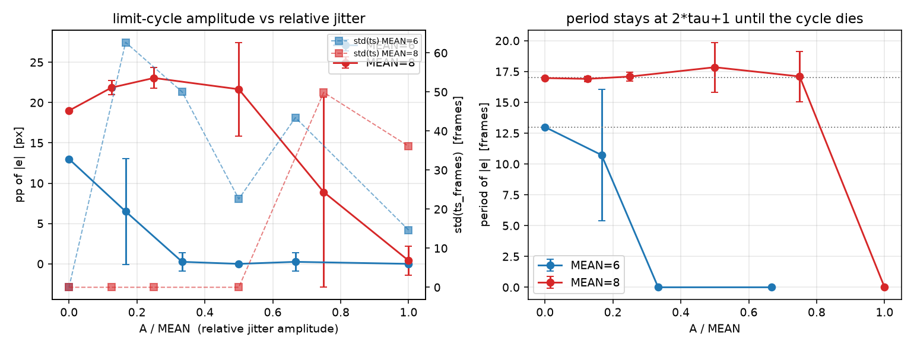

## 8. σ 扫描：固定均值、变抖动幅度（tb 层对称抖动源）

`delay = MEAN + U, U ∈ {-A..+A}` 均匀抽取（tb 内 16 bit Galois LFSR，每帧推 8 步），**均值由构造保证恒等于 MEAN**，方差只由 A 控制。`delay_inject` 仍负责环形缓冲，只把 `d_depth` 改成每帧由 tb 驱动 → **RTL 未改动**。

σ（理论） = √(A(A+1)/3)。A=0 时该路径退化为定值 MEAN，必须与 A 组逐位一致：

| 用例 | conv | ts | e_inf | mp | pp | period | 参照行（mode=1 定值） | 一致？ |
|---|---|---|---|---|---|---|---|---|
| σ 扫描 A=0, MEAN=6 | 0 | -1 | 9.2250 | 4.7750 | 13.0000 | 13.00 | mode=1 τ=6: 0/-1/9.2250/4.7750/13.0000 | **是** |
| σ 扫描 A=0, MEAN=8 | 0 | -1 | 13.5750 | 6.4250 | 19.0000 | 16.97 | mode=1 τ=8: 0/-1/13.5750/6.4250/19.0000 | **是** |

（两列对照：conv/ts/e_inf/mp/pp/period 六项全等才判"是"。）

→ **REF-MATCH：全部相等，通过**（conv/ts/e_inf/mp/pp/period 六项与 A 组定值行逐字段相等；tb 同时打印 `REF,` 行，见 run.log）。这证明"σ=0 的对称抖动源"没有引入任何额外扰动。

### 8.1 MEAN = 6 帧（A 组 g=0.8 的第一个失稳档）

| A | σ | n | 振荡例数 | pp 均值±std | pp 最大 | ts 均值±std（已收敛）| T 均值±std（振荡例）|
|---|---|---|---|---|---|---|---|
| 0 | 0.00 | 1 | 1/1 | 13.00±0.00 | 13.00 | - | 13.00±0.00 (n=1) |
| 1 | 0.82 | 20 | 11/20 | 6.50±6.56 | 16.00 | 167.3±62.7 (n=10) | 10.73±5.31 (n=11) |
| 2 | 1.41 | 20 | 1/20 | 0.25±1.12 | 5.00 | 137.8±50.0 (n=20) | 0.00±0.00 (n=1) |
| 3 | 2.00 | 20 | 0/20 | 0.00±0.00 | 0.00 | 119.4±22.6 (n=20) | - |
| 4 | 2.58 | 20 | 1/20 | 0.25±1.12 | 5.00 | 107.2±43.4 (n=20) | 0.00±0.00 (n=1) |
| 6 | 3.74 | 20 | 0/20 | 0.00±0.00 | 0.00 | 81.7±14.6 (n=20) | - |

### 8.2 MEAN = 8 帧（A 组 g=0.8 的已深度失稳档）

| A | σ | n | 振荡例数 | pp 均值±std | pp 最大 | ts 均值±std（已收敛）| T 均值±std（振荡例）|
|---|---|---|---|---|---|---|---|
| 0 | 0.00 | 1 | 1/1 | 19.00±0.00 | 19.00 | - | 16.97±0.00 (n=1) |
| 1 | 0.82 | 20 | 20/20 | 21.85±0.88 | 23.00 | - | 16.91±0.23 (n=20) |
| 2 | 1.41 | 20 | 20/20 | 23.05±1.28 | 25.00 | - | 17.09±0.35 (n=20) |
| 4 | 2.58 | 20 | 19/20 | 21.65±5.82 | 30.00 | 189.0±0.0 (n=1) | 17.85±2.02 (n=19) |
| 6 | 3.74 | 20 | 8/20 | 8.90±11.80 | 31.00 | 148.9±49.9 (n=12) | 17.10±2.03 (n=8) |
| 8 | 4.90 | 20 | 1/20 | 0.40±1.79 | 8.00 | 119.4±36.1 (n=19) | 0.00±0.00 (n=1) |

### 8.3 临界抖动幅度 A*

| MEAN | A*（pp 均值首次 <0.5 px）| 50% 振荡率插值点 | A*/MEAN | (MEAN−τ_crit) | A*/(MEAN−τ_crit) |
|---|---|---|---|---|---|
| 6 | 2 | 1.10 | 0.333 | 0.25 | 4.40 |
| 8 | 8 | 5.64 | 1.000 | 2.25 | 2.51 |

* **A*/MEAN 不是常数**（0.333 vs 1.000，差 4 倍），所以"临界抖动幅度按均值的固定比例缩放"这个假设**不成立**。
* 换成"相对稳定裕度" (MEAN−τ_crit) 之后，两者的差距从 4 倍缩到 1.75 倍（4.40 vs 2.51），方向上支持"临界抖动按裕度而不是按均值缩放"，但只有 2 个均值点，**只能算提示性证据，不能当结论**——要证实得再补 MEAN=7/9/10。

### 8.4 pp 是否随 A 单调下降？（如实报）

* **MEAN=6：基本单调但不是严格单调。** A=0:13.00 → A=1:6.50 → A=2:0.25 → A=3:0.00 → A=4:0.25 → A=6:0.00。A=2 就掉到 0.25 px，A=3 全 0，但 **A=4 又冒出 1/20 的离群（pp=5 px）**，A=6 再回到 0。这是有限样本的统计涨落（20 次里 1 次），不是"先降后升"的系统趋势；判据用**振荡率**比用 pp 均值稳健。
* **MEAN=8：先升后降，确实不单调。** A=0:19.00 → A=1:21.85 → A=2:23.05 → A=4:21.65 → A=6:8.90 → A=8:0.40。A=1/2 时 pp 比 A=0 还高（19→21.9→23.1），到 A=6 才崩（8.9），A=8 归零。
* 机理：pp 由**瞬时延迟的峰值**决定（极限环幅值 ≈ v·τ_peak，τ_peak = MEAN+A），而"抖动打碎极限环"靠的是**相位失相干**。A 小时峰值先把幅值抬上去（+A 抬 τ_peak），相位还没乱；A 大到与 MEAN 同量级，换向时刻被打散，环就塌了。MEAN=6 因为本来就在阈值边上（τ_crit≈5.75），A=1 就已经过半失稳，看不到抬升段。

### 8.5 周期 T 随 σ 的变化

* MEAN=8、A=0~4 的振荡例：T = 16.97/16.91/17.09/17.85 帧，std 只有 0.23~2.02 帧 —— **周期一点没变宽**，始终是 |e| 口径的 2τ+1（带符号 4τ+2）。
* 也就是说：**相位失相干表现成"幅值塌缩"，而不是"周期变宽/漂移"**。A 跨过临界值后环是**突然消失**（A=6 时 12/20 已收敛），不是逐渐被抹平。

