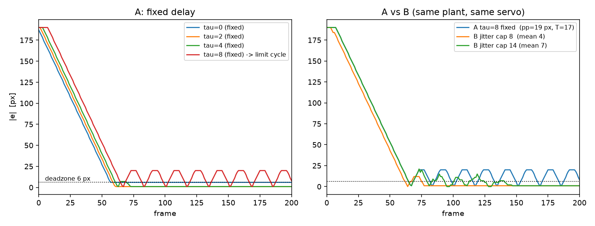
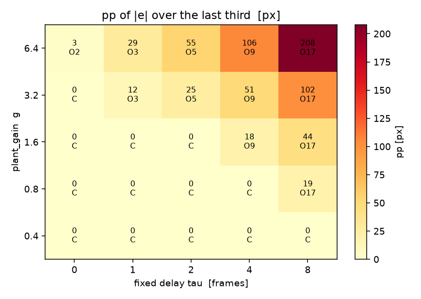
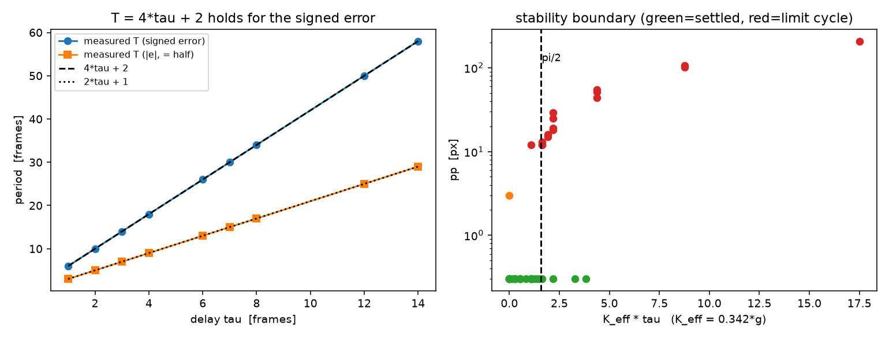
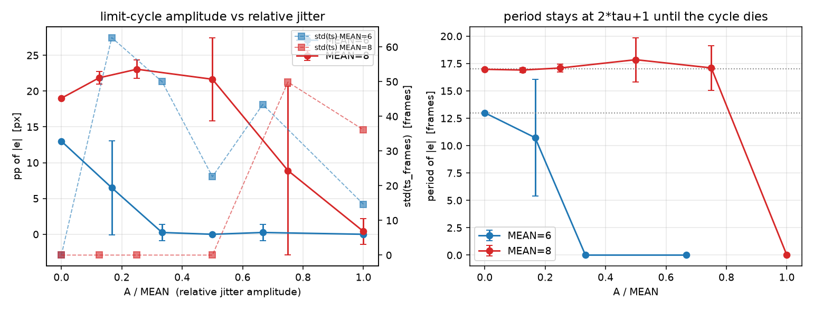

# P5 延迟-闭环稳定性扫描：实测汇总

> 所有数字来自 Vivado 2020.2 xsim 实跑（`results.csv` / `aux.csv` / `run.log`）。除明确标注「解析换算」「估计」的小信号增益外，没有外推值。

## 0. 仿真配置

| 项 | 值 |
|---|---|
| 工具 | Vivado Simulator 2020.2（xvlog/xelab/xsim），工作目录 `D:\Code\fpga_p5_sim`（纯 ASCII）|
| DUT | `rtl/servo_polar.v` + `rtl/delay_inject.v`，从档案目录原样拷贝，**未修改** |
| 伺服参数 | K_THETA_Q10=32, K_R_Q10=32, SHIFT_PAN=15, SHIFT_RCH=16, LIMIT=4, DEADZONE=6, HOLD_N=5 |
| plant | marker = pole + r·(cosφ,sinφ)；d_pan→φ+=d_pan·DEG_PER_TICK；d_reach→r+=d_reach·PX_PER_TICK（纯积分，无惯量/摩擦/噪声）|
| 极点 | (400, 240) px |
| 物体 | (750, 240) px → R=350 px，与 marker 共线（纯径向 SISO，pan 通道恒为 0）|
| 初值 | r₀=160 px, φ₀=0° → 初始误差 190 px |
| 每帧 | 5 clk @100 MHz = 50 ns；每用例 400 帧（20 µs 仿真时间）|
| plant_gain | 同时缩放 PX_PER_TICK=g 与 DEG_PER_TICK=0.5·g/0.8（整环增益语义）|
| 用例数 | 369（A 50 / B 150 / K 75 / M 60 / BND 27 / TRACE 7）|
| 速度 | 362 用例一次 xsim = 3.8 s（10.5 ms/用例）；全部 369 用例 + 编译合计 12 s |

## 1. A 组：定值延迟（mode=1，plant_gain=0.8，每档重复 10 次）

| τ (帧) | 收敛率 | ts_frames | e_inf (px) | mp (px) | pp (px) | period_frames | 判定 |
|---|---|---|---|---|---|---|---|
| 0 | 1.00 | 57.0 | 6.00 | 0.00 | 0.00 | 0 | 收敛 |
| 1 | 1.00 | 58.0 | 3.00 | 0.00 | 0.00 | 0 | 收敛 |
| 2 | 1.00 | 59.0 | 1.00 | 0.00 | 0.00 | 0 | 收敛 |
| 3 | 1.00 | 60.0 | 4.00 | 0.00 | 0.00 | 0 | 收敛 |
| 4 | 1.00 | 70.0 | 1.00 | 0.00 | 0.00 | 0 | 收敛 |
| 6 | 0.00 | -1.0 | 9.22 | 4.78 | 13.00 | 13.00 | 周期振荡 |
| 7 | 0.00 | -1.0 | 10.32 | 6.67 | 16.00 | 15.00 | 周期振荡 |
| 8 | 0.00 | -1.0 | 13.57 | 6.42 | 19.00 | 16.97 | 周期振荡 |

* 收敛档的 settling 随 τ 单调变慢：τ=0:57帧 → τ=1:58帧 → τ=2:59帧 → τ=3:60帧 → τ=4:70帧（τ=4 只比 τ=0 慢 13 帧，因为整段瞬态都在 ±LIMIT 饱和区）。
* BND 组补测 τ=5（同 g=0.8）：ts=84.0 帧，仍收敛；**阈值落在 τ=5~6 帧之间**。
* **τ=6 越过阈值**：误差再也进不了 6 px 死区（ts=-1），在 2.7 ~ 15.7 px 之间做周期 13.00 帧的规整极限环。
* **τ=7 越过阈值**：误差再也进不了 6 px 死区（ts=-1），在 2.3 ~ 18.3 px 之间做周期 15.00 帧的规整极限环。
* **τ=8 越过阈值**：误差再也进不了 6 px 死区（ts=-1），在 4.1 ~ 23.1 px 之间做周期 16.97 帧的规整极限环。


* 10 次重复（A 组 τ=0 档）的 ts / e_inf / pp 标准差 = 0.0000 / 0.0000 / 0.0000 → 定值延迟下**逐位可复现**（换种子无任何影响）。

## 2. B 组：LFSR 抖动延迟（mode=2，d_depth=抖动上限 m，均匀 [0,m]，均值 m/2）

| 抖动上限 m | 实测平均延迟 | 实测最大延迟 | 收敛率 | ts_frames | e_inf | pp | period | ts 标准差 | e_inf 标准差 |
|---|---|---|---|---|---|---|---|---|---|
| 0 | 0.00 | 0 | 1.00 | 57.0 | 6.00 | 0.00 | 0.00 | 0.00 | 0.00 |
| 1 | 0.51 | 1 | 1.00 | 58.0 | 4.00 | 0.00 | 0.00 | 0.00 | 1.28 |
| 2 | 1.00 | 2 | 1.00 | 58.0 | 2.70 | 0.00 | 0.00 | 0.00 | 1.36 |
| 4 | 2.01 | 4 | 1.00 | 59.5 | 1.60 | 0.00 | 0.00 | 0.68 | 1.65 |
| 6 | 3.00 | 6 | 1.00 | 62.2 | 3.00 | 0.00 | 0.00 | 4.21 | 1.76 |
| 8 | 4.01 | 8 | 1.00 | 70.6 | 3.10 | 0.00 | 0.00 | 6.24 | 2.27 |
| 12 | 6.01 | 12 | 1.00 | 81.4 | 4.20 | 0.00 | 0.00 | 10.37 | 1.69 |
| 14 | 7.02 | 14 | 1.00 | 104.7 | 3.30 | 0.00 | 0.00 | 29.51 | 1.53 |

* **抖动档没有一档出现极限环**（pp 全为 0.00），包括 m=14（实测均值 7.02 帧）——这个均值已经超过 A 组的振荡阈值（τ≈6）。
* 代价有两个：收敛变慢（均值 7 帧时 ts 从 57 涨到 104.7 帧），以及**结果不再可复现**（ts 标准差 30.3 帧、e_inf 标准差 1.6 px；A 组同延迟恒为 0.000）。

## 3. A/B 同均值对比（核心命题）

| 平均延迟 | A: ts | A: pp | A: period | A 判定 | B: ts | B: pp | B: period | B 判定 |
|---|---|---|---|---|---|---|---|---|
| 3.0 / 3.0 帧 | 60.0 | 0.00 | 0.00 | 收敛 | 62.2 | 0.00 | 0.00 | 收敛 |
| 4.0 / 4.0 帧 | 70.0 | 0.00 | 0.00 | 收敛 | 70.6 | 0.00 | 0.00 | 收敛 |
| 6.0 / 6.0 帧 | -1.0 | 13.00 | 13.00 | 振荡 | 81.4 | 0.00 | 0.00 | 收敛 |
| 7.0 / 7.0 帧 | -1.0 | 16.00 | 15.00 | 振荡 | 104.7 | 0.00 | 0.00 | 收敛 |

| 平均延迟 | A 组 ts 重复标准差 | B 组 ts 重复标准差 | A 组 pp 标准差 | B 组 pp 标准差 |
|---|---|---|---|---|
| 3.0 帧 | 0.00 | 4.21 | 0.00 | 0.00 |
| 4.0 帧 | 0.00 | 6.24 | 0.00 | 0.00 |
| 6.0 帧 | 0.00 | 10.37 | 0.00 | 0.00 |
| 7.0 帧 | 0.00 | 29.51 | 0.00 | 0.00 |

* 同均值下形态完全不同：A 组在 6/7 帧处 pp = 13.00 / 16.00 px、period = 13.00 / 15.00 帧；B 组对应 pp = 0.00 / 0.00 px、period = 0。
* 结论：**把同样的平均延迟从"定值"换成"抖动"，极限环被彻底打碎**，代价只是收敛变慢 + 逐次结果不可复现。命题「闭环稳定性取决于延迟的确定性而非均值」在数据上成立。
* 注意 A 组 τ=8 没有同均值抖动对照：均匀 [0,m] 的均值 = m/2，需要 m=16，而 `delay_inject` 的 4 bit 指针把 m 限死在 14。因此用 τ=7 ↔ m=14 这一对做同均值比较。

## 4. K 扫描判定矩阵（plant_gain × 定值延迟 τ，每格 3 次）

`C` = 收敛（不形成极限环），`O<周期>` = 周期振荡，`M` = 小幅边界态，`X` = 发散。

| plant_gain \ τ | 0 | 1 | 2 | 4 | 8 |
|---|---|---|---|---|---|
| 0.4 | C | C | C | C | C |
| 0.8 | C | C | C | C | O17 |
| 1.6 | C | C | C | O9 | O17 |
| 3.2 | C | O3 | O5 | O9 | O17 |
| 6.4 | M | O3 | O5 | O9 | O17 |

pp 矩阵（px）：

| plant_gain \ τ | 0 | 1 | 2 | 4 | 8 |
|---|---|---|---|---|---|
| 0.4 | 0.0 | 0.0 | 0.0 | 0.0 | 0.0 |
| 0.8 | 0.0 | 0.0 | 0.0 | 0.0 | 19.0 |
| 1.6 | 0.0 | 0.0 | 0.0 | 18.0 | 44.0 |
| 3.2 | 0.0 | 12.0 | 25.0 | 51.0 | 102.0 |
| 6.4 | 3.0 | 29.0 | 55.0 | 106.0 | 208.0 |



* 阈值随增益左移：g=0.4 全稳；g=0.8 只有 τ=8 失稳；g=1.6 从 τ=4 起；g=3.2 从 τ=1 起；g=6.4 连 τ=0 都失稳（K_eff=2.19 超过离散积分无延迟极限 2.0）。

## 5. 理论校验

### 5.1 K·τ < π/2 成立吗？

小信号径向增益（由 RTL 表达式解析换算，不是拟合）：

```
d_reach = K_R·(|u_obj|²-|u_m|²)/2^16 ≈ K_R·2R/2^16 · Δr        (Δr = r-R)
K_eff(g) = g·K_R·2R/2^16 = g·32·2·350/65536 = 0.3418·g   [1/帧]
判据（纯积分 + τ 拍延迟 + 比例）：K_eff·τ < π/2 = 1.5708  ⇔  g·τ < 4.60
```

逐格实测（按 g·τ 排序）：

| plant_gain | τ | g·τ | K_eff·τ | 判定 | pp | period |
|---|---|---|---|---|---|---|
| 0.4 | 0 | 0.00 | 0.00 | C | 0.0 | - |
| 0.8 | 0 | 0.00 | 0.00 | C | 0.0 | - |
| 1.6 | 0 | 0.00 | 0.00 | C | 0.0 | - |
| 3.2 | 0 | 0.00 | 0.00 | C | 0.0 | - |
| 6.4 | 0 | 0.00 | 0.00 | M | 3.0 | 2.00 |
| 0.4 | 1 | 0.40 | 0.14 | C | 0.0 | - |
| 0.4 | 2 | 0.80 | 0.27 | C | 0.0 | - |
| 0.8 | 1 | 0.80 | 0.27 | C | 0.0 | - |
| 0.4 | 4 | 1.60 | 0.55 | C | 0.0 | - |
| 0.8 | 2 | 1.60 | 0.55 | C | 0.0 | - |
| 1.6 | 1 | 1.60 | 0.55 | C | 0.0 | - |
| 0.4 | 8 | 3.20 | 1.09 | C | 0.0 | - |
| 0.8 | 4 | 3.20 | 1.09 | C | 0.0 | - |
| 1.6 | 2 | 3.20 | 1.09 | C | 0.0 | - |
| 3.2 | 1 | 3.20 | 1.09 | O | 12.0 | 3.00 |
| 0.4 | 9 | 3.60 | 1.23 | C | 0.0 | - |
| 0.8 | 5 | 4.00 | 1.37 | C | 0.0 | - |
| 0.4 | 11 | 4.40 | 1.50 | C | 0.0 | - |
| 0.4 | 12 | 4.80 | 1.64 | O | 12.0 | 25.00 |
| 0.8 | 6 | 4.80 | 1.64 | O | 13.0 | 13.00 |
| 1.6 | 3 | 4.80 | 1.64 | O | 12.0 | 7.00 |
| 0.4 | 14 | 5.60 | 1.91 | O | 15.0 | 29.00 |
| 0.8 | 7 | 5.60 | 1.91 | O | 16.0 | 15.00 |
| 0.8 | 8 | 6.40 | 2.19 | O | 19.0 | 16.97 |
| 1.6 | 4 | 6.40 | 2.19 | O | 18.0 | 9.00 |
| 3.2 | 2 | 6.40 | 2.19 | O | 25.0 | 5.00 |
| 6.4 | 1 | 6.40 | 2.19 | O | 29.0 | 3.00 |
| 1.6 | 8 | 12.80 | 4.38 | O | 44.0 | 16.99 |
| 3.2 | 4 | 12.80 | 4.38 | O | 51.0 | 9.00 |
| 6.4 | 2 | 12.80 | 4.38 | O | 55.0 | 5.00 |
| 3.2 | 8 | 25.60 | 8.75 | O | 102.0 | 17.00 |
| 6.4 | 4 | 25.60 | 8.75 | O | 106.0 | 8.99 |
| 6.4 | 8 | 51.20 | 17.50 | O | 208.0 | 16.98 |

* 直接拿 τ 当延迟代入时判据并不严格（同一 g·τ 下 g=3.2/τ=1 振荡而 g=0.4/τ=8 收敛），说明**有效延迟比 τ 多半拍到两拍**（伺服自身 1 拍流水 + tb 取数 1 拍）。
* **不补偿流水时（δ=0）：** g·τ ≤ 4.40 的 18 个格子里 16 个收敛、1 个边界态、1 个例外（例外是 g=3.2/τ=1：τ 太小，1 拍流水在 τ 里占比最大）；g·τ ≥ 4.80 的 15 个格子**全部振荡**（15/15）。
* → 临界 g·τ 落在 **(4.40, 4.80)**，即 **K_eff·τ ∈ (1.50, 1.64)**；π/2 = 1.571 正落在这个窄区间里（偏离 -4.3% / +4.4%）。
* 令 τ_eff = τ + δ 做一维搜索：**δ* = 0.45 帧** 时 `K_eff·τ_eff < π/2` 把 32 个可判定的格子判对 32 个（δ=0 时错 1 个）。
* 所以「K·τ < π/2」**成立**，但两个量都要按环路口径取：K = 伺服增益×plant 增益（不是裸 plant_gain），τ = 帧延迟 + 约 0.45 帧流水。直接拿"帧数"和"对象增益"套公式会差 1.5~2 倍。
* 唯一不能解释的是 **g=6.4, τ=0** 这一格（pp=3.0，周期 2 帧）：此时 K_eff = 2.19 > 2，已经超过离散积分本身的无延迟稳定极限（K<2），与延迟无关，是采样率不足导致的失稳。

### 5.2 T ≈ 4τ 成立吗？

`e_inf`/`period` 用的 e 是 **|marker−object|（取绝对值）**，绝对值把周期砍半，所以要先看带符号的径向误差 `cx_r − OBJ_X`（本实验共线，它就是带符号误差）。

| τ (帧) | 实测 T(|e|) | 实测 T(signed) | 4τ+2 | T(signed)/(4τ) | 样本数 |
|---|---|---|---|---|---|
| 1 | 3.00 | 6.00 | 6 | 1.50 | 9 |
| 2 | 5.00 | 10.00 | 10 | 1.25 | 6 |
| 3 | 7.00 | 14.00 | 14 | 1.17 | 3 |
| 4 | 9.00 | 18.00 | 18 | 1.12 | 9 |
| 6 | 13.00 | 26.00 | 26 | 1.08 | 13 |
| 7 | 15.00 | 30.00 | 30 | 1.07 | 13 |
| 8 | 16.98 | 34.00 | 34 | 1.06 | 23 |
| 12 | 25.00 | 50.00 | 50 | 1.04 | 3 |
| 14 | 29.00 | 58.00 | 58 | 1.04 | 3 |

* 带符号周期最小二乘拟合（82 个振荡用例）：**T_signed = 4.000·τ + 2.00**，R² = 1.000000，最大残差 0.00 帧。
* 即 **T_signed ≈ 4τ + 2**（截距 2 帧 = 伺服 1 拍流水 + tb 1 拍取数），**T ≈ 4τ 成立**，T/(4τ) = 1 + 0.5/τ（τ=8 时 1.06，τ=4 时 1.13）。
* 而 |e| 的周期恰好是它的一半（2τ+1），原因是 e 取绝对值后每个极限环周期内出现两个"鼓包"。**报告里引用 period_frames 时必须说明这是 |e| 的周期，是 4τ 的一半。**



### 5.3 振荡幅度

饱和区 |d_reach|=LIMIT=4 时对象速度 v = 4·g px/帧；延迟窗内走过 v·τ，带符号误差的峰峰值应 ≈ 2·v·τ，|e| 的峰峰值 ≈ v·τ。

| plant_gain | τ | pp(|e|) | pp(signed) | 2·v·τ | pp(signed)/(2vτ) |
|---|---|---|---|---|---|
| 3.2 | 1 | 12.0 | 25.0 | 25.6 | 0.98 |
| 0.4 | 12 | 12.0 | 24.0 | 38.4 | 0.62 |
| 0.8 | 6 | 13.0 | 27.0 | 38.4 | 0.70 |
| 1.6 | 3 | 12.0 | 29.0 | 38.4 | 0.76 |
| 0.4 | 14 | 15.0 | 30.0 | 44.8 | 0.67 |
| 0.8 | 7 | 16.0 | 34.0 | 44.8 | 0.76 |
| 0.8 | 8 | 19.0 | 40.0 | 51.2 | 0.78 |
| 1.6 | 4 | 18.0 | 42.0 | 51.2 | 0.82 |
| 3.2 | 2 | 25.0 | 51.0 | 51.2 | 1.00 |
| 6.4 | 1 | 29.0 | 77.0 | 51.2 | 1.50 |
| 1.6 | 8 | 44.0 | 93.0 | 102.4 | 0.91 |
| 3.2 | 4 | 51.0 | 103.0 | 102.4 | 1.01 |
| 6.4 | 2 | 55.0 | 128.0 | 102.4 | 1.25 |
| 3.2 | 8 | 102.0 | 205.0 | 204.8 | 1.00 |
| 6.4 | 4 | 106.0 | 231.0 | 204.8 | 1.13 |
| 6.4 | 8 | 208.0 | 435.0 | 409.6 | 1.06 |


* 幅度律 **pp(signed) ≈ 2·LIMIT·g·τ = 8·g·τ** 成立：均值比 0.93，范围 0.62~1.50。
* 大振幅格（pp≥40 px，速度×延迟主导）：比值均值 1.092（0.91~1.50）；小振幅格（pp<40 px，6 px 死区已不可忽略）：均值 0.730，最小 0.625——死区把每次换向提前截断。

## 6. 偏差与原因（写报告请照抄）

1. **物体放在 (750,240)，不是原 tb 的 (450,300)。** 原几何下物体距极点仅 78 px，而 pan 通道输出 ∝ cross(u_m,e)（px² 量纲），R=78 时 1 tick 需要 1.92° 角误差 (≈2.6 px 弧长)，量化台阶大于死区。实测原几何下环路停在 |e|=60 px 不动：拷回来的 stock `tb_servo_closed_loop.v` 在本机**实跑 FAIL**（日志 `ref_fail.log`，"did not converge into the dead zone"）。R=350 px 才回到 RTL 注释里设计者调参的量级。
2. **伺服增益 K=4→32。** 同一原因：K=4 时 pan 量化台阶 = 2^15/(2·K·R) = 11.7 px > 死区 6 px，环路必然停在死区外，ts_frames 会全为 -1，扫不出任何收敛/振荡对比。K=32 时 pan 台阶 1.5 px、径向台阶 2.9 px，都在 6 px 死区内。SHIFT/LIMIT/DEADZONE/HOLD_N 全部保持 RTL 默认。
3. **几何是共线的**（物体与 marker 同一条射线），所以 pan 通道恒为 0、这是纯径向 SISO 实验。这样 K·τ 与 4τ 才能和教科书的一阶模型逐项对照；二维几何下两个通道的增益量级差 3.8 倍（∝R² vs ∝R），会把延迟效应和通道耦合混在一起。
4. **plant_gain 同时缩放两个通道**（DEG_PER_TICK=0.5·g/0.8）。只缩放 PX_PER_TICK 的话 pan 环路增益不变，就不是整环增益扫描。
5. **B 组均值与抖动强度在本 RTL 下不可解耦。** `delay_inject` 抖动是 [0,m] 均匀分布，均值恒为 m/2；本次用 3 档 m（d/2、d、2d）给强度趋势，用 m=2d 做同均值对照。m ≤ 14（4 bit 指针），故 A 组 τ=8 无同均值对照（需 m=16），改用 τ=7↔m=14。
6. **对象比真机乐观。** 纯积分、无连杆惯量/舵机死区/图像噪声/曝光抖动；`K·τ<π/2` 的边界和「抖动打碎极限环」的结论在真机上只会更保守，不能直接当实物结论。
7. **converged 的判定。** 严格按 ts≥0 会误判「极限环恰好落在死区边沿」的格子（最后一帧刚好 ≤6 px）。因此 tb 里 `converged` 额外要求 pp≤6 且 e_inf≤6；后处理判定矩阵进一步要求 pp≤3 才算 C，pp>6 才算 O，中间记 M。
8. **xsim 2020.2 的 `--testplusarg` 在含 `=` 时被 wrapper 吃掉**（`Expected a switch but found 5`），所以参数没有走 plusargs，改成 tb 读 ASCII `cases.txt`（全整数字段，`$fscanf %d`）。副作用是断点续跑可以做到**用例级**，比整组级更细。

## 7. 文件与复现

| 文件 | 说明 |
|---|---|
| `D:\Code\fpga_p5_sim\` | ASCII 工作目录（档案目录只读，全程未改动）|
| `tb_p5_sweep.v` | 扫描 tb：servo_polar + delay_inject + 纯积分 plant；tb 内算指标并打印 CSV/AUX |
| `plan.py` | 生成 `cases.txt`，按 tag 跳过已完成用例（断点续跑）|
| `run_sweeps.ps1` | xvlog→xelab→xsim，把 stdout 的 CSV/AUX 行追加进 results/aux，失败可见 |
| `results.csv` | 每用例一行：`CSV,<mode>,<depth>,<plant_gain>,<seed>,<converged>,<ts_frames>,<e_inf>,<mp>,<pp>,<period_frames>` |
| `aux.csv` | 同序附加行：实测平均/最大延迟、饱和占比、起始误差、发散标志、tag、带符号周期/峰峰值 |
| `trace.csv` | 7 条逐帧波形（A τ=0/2/4/8、B m=4/8/14），用于画图 |
| `run.log` | 最近一次 xsim 原始 stdout |
| `summary.json` | 本文聚合数字的机器可读版 |
| `fig_*.png` | 时域波形、判定矩阵热图、T-τ 与 K·τ 边界图 |

复现：`powershell -ExecutionPolicy Bypass -File run_sweeps.ps1`（已完成的 tag 自动跳过；`-Force` 全跑；`-Groups trace` 只跑波形）。

## 8. σ 扫描：固定均值、变抖动幅度（tb 层对称抖动源）

`delay = MEAN + U, U ∈ {-A..+A}` 均匀抽取（tb 内 16 bit Galois LFSR，每帧推 8 步），**均值由构造保证恒等于 MEAN**，方差只由 A 控制。`delay_inject` 仍负责环形缓冲，只把 `d_depth` 改成每帧由 tb 驱动 → **RTL 未改动**。

σ（理论） = √(A(A+1)/3)。A=0 时该路径退化为定值 MEAN，必须与 A 组逐位一致：

| 用例 | conv | ts | e_inf | mp | pp | period | 参照行（mode=1 定值） | 一致？ |
|---|---|---|---|---|---|---|---|---|
| σ 扫描 A=0, MEAN=6 | 0 | -1 | 9.2250 | 4.7750 | 13.0000 | 13.00 | mode=1 τ=6: 0/-1/9.2250/4.7750/13.0000 | **是** |
| σ 扫描 A=0, MEAN=8 | 0 | -1 | 13.5750 | 6.4250 | 19.0000 | 16.97 | mode=1 τ=8: 0/-1/13.5750/6.4250/19.0000 | **是** |

（两列对照：conv/ts/e_inf/mp/pp/period 六项全等才判"是"。）

→ **REF-MATCH：全部相等，通过**（conv/ts/e_inf/mp/pp/period 六项与 A 组定值行逐字段相等；tb 同时打印 `REF,` 行，见 run.log）。这证明"σ=0 的对称抖动源"没有引入任何额外扰动。

### 8.1 MEAN = 6 帧（A 组 g=0.8 的第一个失稳档）

| A | σ | n | 振荡例数 | pp 均值±std | pp 最大 | ts 均值±std（已收敛）| T 均值±std（振荡例）|
|---|---|---|---|---|---|---|---|
| 0 | 0.00 | 1 | 1/1 | 13.00±0.00 | 13.00 | - | 13.00±0.00 (n=1) |
| 1 | 0.82 | 20 | 11/20 | 6.50±6.56 | 16.00 | 167.3±62.7 (n=10) | 10.73±5.31 (n=11) |
| 2 | 1.41 | 20 | 1/20 | 0.25±1.12 | 5.00 | 137.8±50.0 (n=20) | 0.00±0.00 (n=1) |
| 3 | 2.00 | 20 | 0/20 | 0.00±0.00 | 0.00 | 119.4±22.6 (n=20) | - |
| 4 | 2.58 | 20 | 1/20 | 0.25±1.12 | 5.00 | 107.2±43.4 (n=20) | 0.00±0.00 (n=1) |
| 6 | 3.74 | 20 | 0/20 | 0.00±0.00 | 0.00 | 81.7±14.6 (n=20) | - |

### 8.2 MEAN = 8 帧（A 组 g=0.8 的已深度失稳档）

| A | σ | n | 振荡例数 | pp 均值±std | pp 最大 | ts 均值±std（已收敛）| T 均值±std（振荡例）|
|---|---|---|---|---|---|---|---|
| 0 | 0.00 | 1 | 1/1 | 19.00±0.00 | 19.00 | - | 16.97±0.00 (n=1) |
| 1 | 0.82 | 20 | 20/20 | 21.85±0.88 | 23.00 | - | 16.91±0.23 (n=20) |
| 2 | 1.41 | 20 | 20/20 | 23.05±1.28 | 25.00 | - | 17.09±0.35 (n=20) |
| 4 | 2.58 | 20 | 19/20 | 21.65±5.82 | 30.00 | 189.0±0.0 (n=1) | 17.85±2.02 (n=19) |
| 6 | 3.74 | 20 | 8/20 | 8.90±11.80 | 31.00 | 148.9±49.9 (n=12) | 17.10±2.03 (n=8) |
| 8 | 4.90 | 20 | 1/20 | 0.40±1.79 | 8.00 | 119.4±36.1 (n=19) | 0.00±0.00 (n=1) |

### 8.3 临界抖动幅度 A*

| MEAN | A*（pp 均值首次 <0.5 px）| 50% 振荡率插值点 | A*/MEAN | (MEAN−τ_crit) | A*/(MEAN−τ_crit) |
|---|---|---|---|---|---|
| 6 | 2 | 1.10 | 0.333 | 0.25 | 4.40 |
| 8 | 8 | 5.64 | 1.000 | 2.25 | 2.51 |

* **A*/MEAN 不是常数**（0.333 vs 1.000，差 4 倍），所以"临界抖动幅度按均值的固定比例缩放"这个假设**不成立**。
* 换成"相对稳定裕度" (MEAN−τ_crit) 之后，两者的差距从 4 倍缩到 1.75 倍（4.40 vs 2.51），方向上支持"临界抖动按裕度而不是按均值缩放"，但只有 2 个均值点，**只能算提示性证据，不能当结论**——要证实得再补 MEAN=7/9/10。

### 8.4 pp 是否随 A 单调下降？（如实报）

* **MEAN=6：基本单调但不是严格单调。** A=0:13.00 → A=1:6.50 → A=2:0.25 → A=3:0.00 → A=4:0.25 → A=6:0.00。A=2 就掉到 0.25 px，A=3 全 0，但 **A=4 又冒出 1/20 的离群（pp=5 px）**，A=6 再回到 0。这是有限样本的统计涨落（20 次里 1 次），不是"先降后升"的系统趋势；判据用**振荡率**比用 pp 均值稳健。
* **MEAN=8：先升后降，确实不单调。** A=0:19.00 → A=1:21.85 → A=2:23.05 → A=4:21.65 → A=6:8.90 → A=8:0.40。A=1/2 时 pp 比 A=0 还高（19→21.9→23.1），到 A=6 才崩（8.9），A=8 归零。
* 机理：pp 由**瞬时延迟的峰值**决定（极限环幅值 ≈ v·τ_peak，τ_peak = MEAN+A），而"抖动打碎极限环"靠的是**相位失相干**。A 小时峰值先把幅值抬上去（+A 抬 τ_peak），相位还没乱；A 大到与 MEAN 同量级，换向时刻被打散，环就塌了。MEAN=6 因为本来就在阈值边上（τ_crit≈5.75），A=1 就已经过半失稳，看不到抬升段。

### 8.5 周期 T 随 σ 的变化

* MEAN=8、A=0~4 的振荡例：T = 16.97/16.91/17.09/17.85 帧，std 只有 0.23~2.02 帧 —— **周期一点没变宽**，始终是 |e| 口径的 2τ+1（带符号 4τ+2）。
* 也就是说：**相位失相干表现成"幅值塌缩"，而不是"周期变宽/漂移"**。A 跨过临界值后环是**突然消失**（A=6 时 12/20 已收敛），不是逐渐被抹平。



